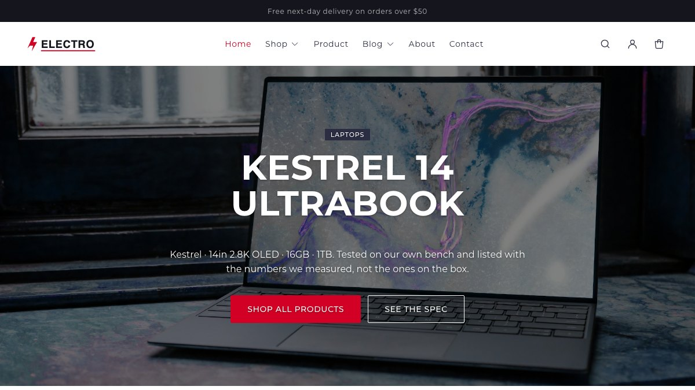
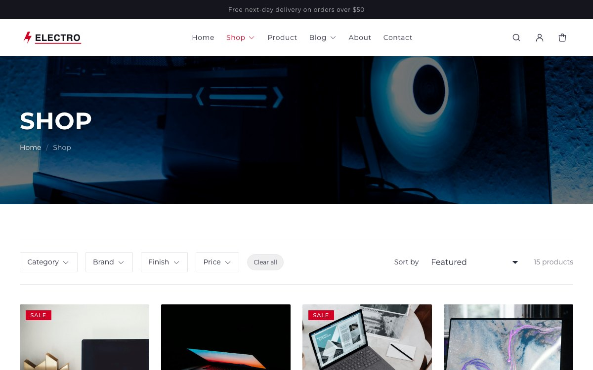
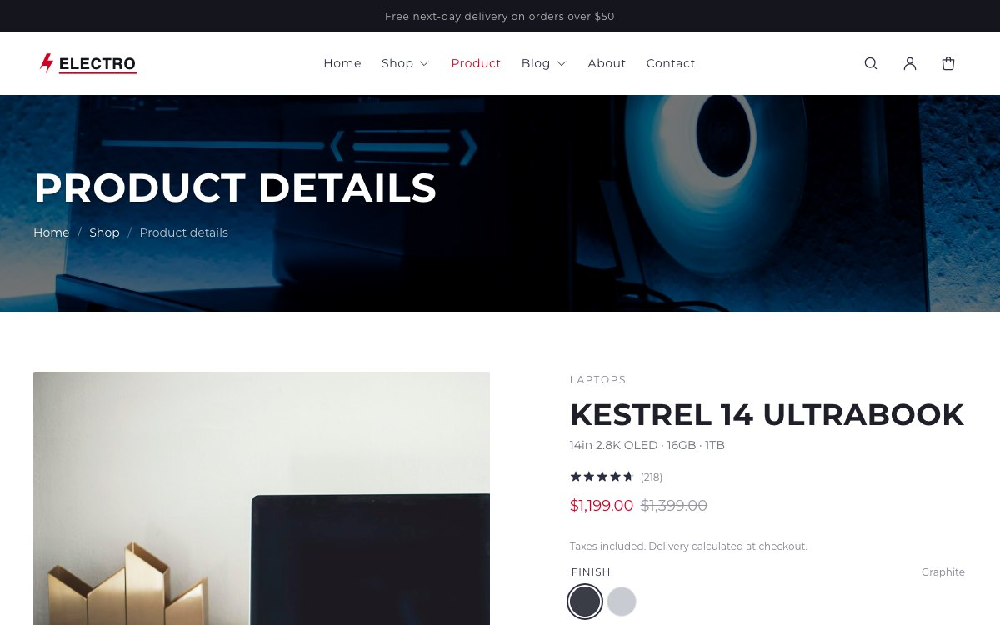
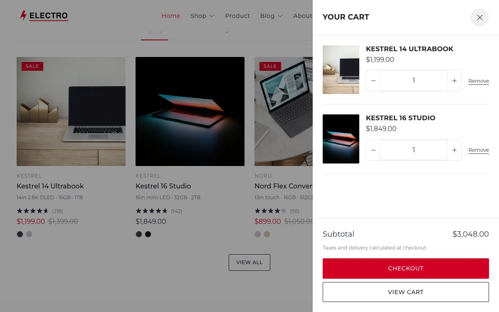
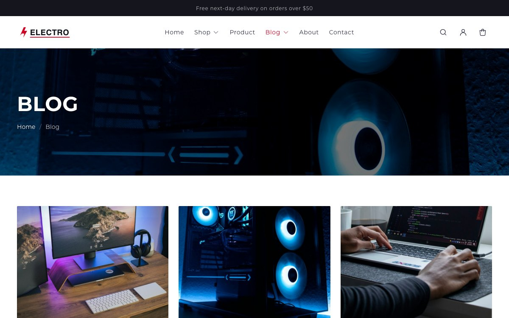
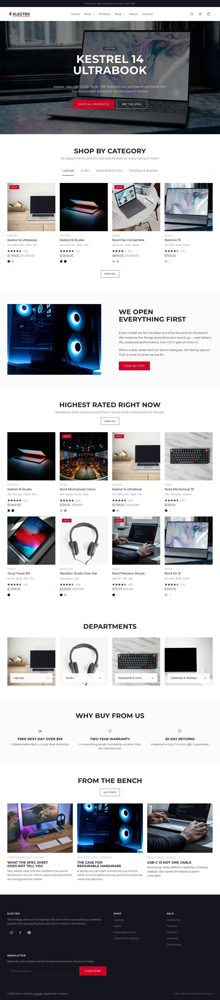
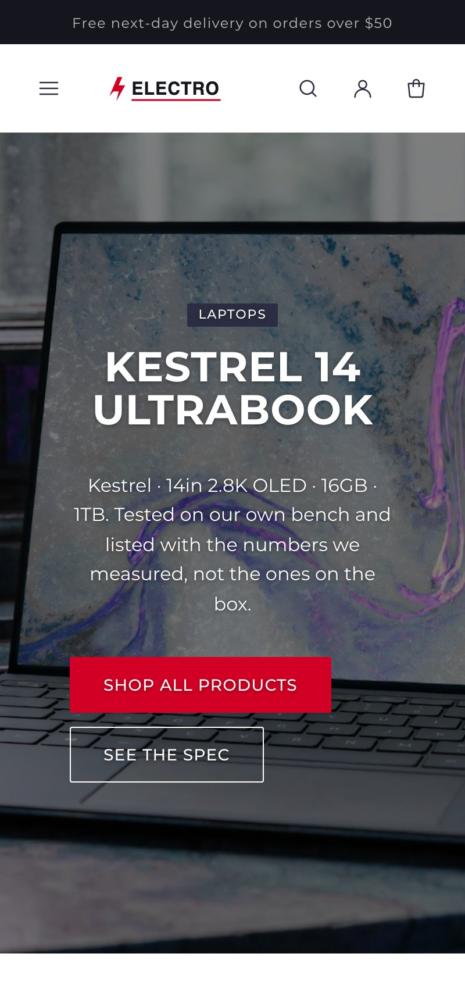

# Electro — free Shopify theme for electronics

A free Shopify theme for computing, audio and peripherals stores — anywhere the
brand, the specification and the rating decide the sale. Built on Online Store
2.0 theme blocks, with no jQuery, no CSS framework and nothing fetched from a
third-party CDN.

<p align="center">
  <a href="https://preview.colorlib.com/theme/electro/"><strong>Live preview</strong></a> ·
  <a href="https://downloads.colorlib.com/theme/electro-shopify-theme.zip"><strong>Download the theme</strong></a> ·
  <a href="https://colorlib.com/wp/free-best-shopify-themes/"><strong>More free Shopify themes</strong></a>
</p>

<p align="center">
  
  
  
</p>

<p align="center">
  
</p>

## Preview

**[preview.colorlib.com/theme/electro](https://preview.colorlib.com/theme/electro/)**

The preview is a static build of the same design rather than a live storefront.
It and this theme share `assets/base.css` — literally the same file — so what you
see there is what the Liquid renders.

| | |
|---|---|
|  |  |
| **Shop** — filter by category, brand, finish and price | **Product** — with the specification table |
|  |  |
| **Cart drawer** — ajax, no page reload | **Blog** — plus about, contact and full customer accounts |

<details>
<summary>The whole homepage, and the mobile layout</summary>
<br>


</details>

## What you get

- **Specification table block** — the component an electronics listing lives or
  dies on. Rows come from a product metafield, so each product carries its own
  without rebuilding the block, and it renders nothing at all when unset rather
  than an empty shell.
- **Brand and rating on every card** — `vendor` is shown as the brand and
  `reviews.rating` drives the stars, both toggleable in theme settings.
- **Category tabs** — a homepage grid where each tab is one of your collections.
  Every panel renders with the page, so switching costs no request and works with
  JavaScript disabled. Full ARIA tabs pattern including arrow-key navigation.
- **Filterable collections** through Shopify's free Search & Discovery app.
- **Product pages built from blocks** — title, vendor, price, variant picker,
  quantity, buy buttons, stock status, description, specification table and
  collapsible rows, each movable in the editor.
- **Ajax cart drawer** with quick add straight from the grid.
- **Predictive search**, **Shopify Markets**, **breadcrumbs** as `BreadcrumbList`.
- **Four editable colour schemes** applied per section, plus font, spacing,
  radius, card and star-colour controls.

## Install

Upload `electro-shopify-theme.zip` in **Online Store → Themes → Add theme →
Upload zip file**. Do not unzip it first. Then **Customize** and **Publish**.

```bash
npm install -g @shopify/cli
shopify theme dev --store your-store.myshopify.com
shopify theme check                                  # currently: 0 offenses
shopify theme push
```

## Setting it up as an electronics store

| Shopify field | Used as |
|---|---|
| Product **vendor** | the brand, shown above the title on cards and the product page |
| `reviews.rating` metafield | the star rating (any review app writing the standard metafield) |
| `specs` namespace metafield | the specification table — see below |
| Variant option | finish: Graphite / Silver / Midnight / White … |

### The specification table

Create a product metafield in the **`specs`** namespace. The block reads the key
named in its settings (`table` by default) and accepts either shape:

- **JSON** — `[{"label": "Display", "value": "14in 2.8K OLED"}, …]`
- **List of single-line text** — `["Display: 14in 2.8K OLED", "Memory: 16GB"]`,
  where everything before the first colon is the label. This is the one a
  merchant can fill in without writing JSON.

The table scrolls inside its own container, so a wide row never pushes the page
into a horizontal scroll on a phone.

## Shared design system

`assets/base.css` is the same stylesheet behind
[Furn](https://github.com/ColorlibHQ/Furn),
[Fashe](https://github.com/ColorlibHQ/Fashe) and ABC Book. Only the theme
settings differ — colours, type, radius, heading case.

The [Electro HTML template](https://preview.colorlib.com/theme/electro/) is a
static build of this same design system: its `assets/css/style.css` is a token
block plus this file copied verbatim, and `build/check-tokens.py` there fails if
its tokens stop matching `config/settings_data.json`.

## Notes

- `shopify theme check`: 99 files, 0 errors, 0 warnings.
- Two asset files, no build step, no minification, no Sass.
- English only; both locale files are complete and fully keyed.
- Not yet rendered against a live store with real inventory.

## Licence

Free to use and modify on any number of Shopify stores, including client stores.
Please do not repackage and resell the theme itself.

## Credits

Built by [Colorlib](https://colorlib.com). Architecture shared with the
[Furn](https://github.com/ColorlibHQ/Furn) and
[Fashe](https://github.com/ColorlibHQ/Fashe) Shopify themes.
